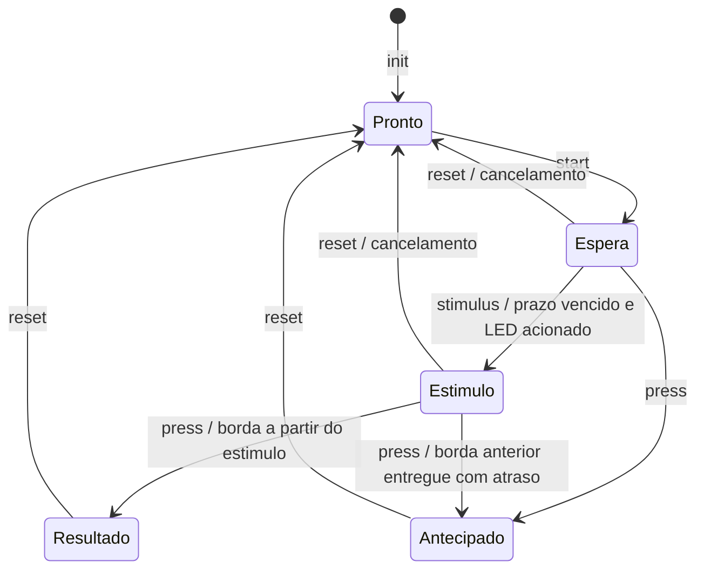

# Lógica do teste de reação — etapa 2

O módulo recebe timestamps de milissegundos e decide o estado da rodada.
Não configura EXTI, não acende o LED e não imprime. Isso permite testar o
mesmo código C no computador e compilá-lo para o STM32F411.

## Estados

| Estado C | Significado |
| --- | --- |
| `REACTION_IDLE` | Pode iniciar uma rodada; a integração ainda precisa verificar USB e botão solto |
| `REACTION_WAITING` | Espera em andamento; o estímulo ainda não ocorreu |
| `REACTION_STIMULUS` | Estímulo registrado, aguardando um pressionamento válido |
| `REACTION_RESULT` | Tempo de reação disponível em `reaction_ms` |
| `REACTION_EARLY` | Tentativa antecipada; a integração deverá informar `Muito cedo!` |

`reaction_logic_wait_elapsed()` apenas consulta o prazo. Mesmo com o prazo
vencido, um pressionamento é antecipado enquanto o LED não tiver sido
acionado e `reaction_logic_stimulus()` não tiver registrado esse instante.
Por exemplo, se a espera termina em 3000 ms, mas o LED só é acionado em
3017 ms, uma borda em 3301 ms representa **284 ms**, não 301 ms.

O módulo aceita só o primeiro pressionamento que encerra a rodada. Novos
eventos não sobrescrevem o resultado, e `start()` não reinicia uma rodada
em andamento ou com resultado pendente. `reset()` libera o estado ou cancela
a rodada; não inicia outra nem altera GPIO.

## Espera variável

O intervalo de **2 a 5 segundos, inclusive**, é uma escolha deste projeto;
o enunciado pede alguns segundos sem revelar o instante exato do estímulo.
Usamos xorshift32, com estado de 32 bits e semente fornecida na inicialização.
Uma semente zero é substituída para evitar a sequência permanentemente nula.
O estado do gerador é preservado entre rodadas e cancelamentos.

É uma sequência pseudoaleatória: a mesma semente reproduz os mesmos tempos.
O módulo não coleta entropia. Na integração, a semente deverá incorporar
um instante de interação, como a abertura do terminal, para variar entre
execuções; apenas um identificador fixo da placa não varia após RESET.
A duração escolhida não deverá ser anunciada antes do estímulo.

## Timestamps e debounce

`reaction_logic_press()` recebe o instante da borda que originou o
pressionamento validado. O instante em que o debounce termina não deve ser
usado como o tempo do pressionamento. Se a borda foi anterior ao estímulo e
só for entregue depois dele, continua sendo uma antecipação.

O cálculo usa diferenças `uint32_t`, permitindo atravessar a passagem de
`UINT32_MAX` para zero. O contrato exige que uma rodada e os atrasos de
entrega sejam menores que **2³¹ ms**, aproximadamente 24,9 dias, para
distinguir eventos anteriores ao início da rodada. O contador completo
tem período de aproximadamente 49,7 dias. Eventos devem ser entregues em
ordem; os anteriores ao início da rodada são ignorados.

Uma borda com o mesmo timestamp do estímulo resulta em **0 ms**. A resolução
de 1 ms não distingue a ordem física de duas ações dentro desse intervalo.
A integração deverá tratar pendências de EXTI e pressão em validação antes
de emitir o estímulo, para não transformar uma antecipação em reação válida.

## Contrato da integração da etapa 3

1. Inicializar o módulo, anunciar prontidão e exigir botão solto estável
   antes de iniciar a espera. Não usar `start()` para descartar um resultado
   ainda não transmitido.
2. Capturar o botão por EXTI e preservar o timestamp da borda durante a
   validação do pressionamento. Nenhuma consulta deste módulo substitui EXTI.
3. Quando a espera vencer, conferir pressão/pendências antes de acender o LED.
   Registrar o estímulo junto ao acionamento de PC13 em uma seção crítica
   curta. A referência temporal é o LED, não a chegada de texto pelo USB.
4. Serializar os acessos ao estado entre `main` e interrupções. Estas funções
   não fornecem proteção própria contra concorrência.
5. Formatar e transmitir as mensagens no laço principal, tratando USB ocupado
   e conclusão de envio. Desligar o LED ao concluir/cancelar e exigir soltura
   estável antes de uma nova rodada.

Essas integrações ainda não estão implementadas. Os testes desta etapa
fornecem timestamps simulados diretamente ao módulo; não comprovam debounce,
concorrência de interrupções, temporização elétrica ou comportamento do USB.
