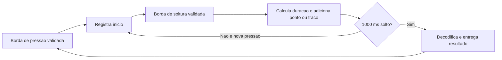

# Lógica Morse — etapa 2

O módulo `morse_logic.c` recebe bordas já validadas e timestamps. Ele mede
pressões, acumula símbolos e produz uma letra ou erro. Não acessa GPIO,
EXTI, USB ou o SysTick diretamente. A integração com a placa está no [guia da etapa 3](integracao.md).

## Convenções deste projeto

| Parâmetro | Regra |
| --- | --- |
| Ponto | Pressão validada com duração menor que 300 ms |
| Traço | Pressão validada com duração de 300 ms ou mais |
| Fim da letra | 1000 ms após a última soltura, sem nova pressão |
| Alfabeto | A–Z, sem acentos, números ou pontuação |
| Capacidade | Até 4 símbolos por letra; a partir do quinto, letra longa demais |

O enunciado fixa o intervalo de 1 segundo, mas não define a separação entre
pressão curta e longa. **300 ms é uma escolha de implementação**, ajustável
em `MORSE_DASH_MIN_MS`. Não é uma exigência do professor nem uma duração
universal do código Morse. O intervalo solto permite fazer traços longos sem
encerrar a letra enquanto o botão continua apertado.

A tabela de A–Z foi conferida no Anexo 1, parte I, seção 1.1.1 da
[recomendação ITU-R M.1677-1](https://www.itu.int/dms_pubrec/itu-r/rec/m/R-REC-M.1677-1-200910-I%21%21PDF-E.pdf).
Este exercício usa o intervalo fixo do enunciado e classificação por limiar;
não implementa todas as regras de temporização e sinais dessa recomendação.

## Fluxo

Cada soltura completa exatamente um símbolo. Bordas repetidas do mesmo nível
não reiniciam duração ou intervalo. Não existe emissão por intervalo vazio,
nem repetição do resultado em ticks posteriores. A saída é uma cópia, e a
sequência interna é limpa para receber a próxima letra.

O resultado contém `kind`, `symbols`, `letter` e `finished_at`:

- `MORSE_LETTER`: letra A–Z reconhecida e sequência completa.
- `MORSE_UNKNOWN`: até 4 símbolos sem correspondência, como `----`; `letter=0`.
- `MORSE_TOO_LONG`: mais de 4 símbolos; `letter=0`, preservando somente os
  primeiros 4 em `symbols`. A integração deve avisar que a sequência foi
  truncada, sem apresentá-la como completa ou decodificar seu prefixo.

Após exceder o limite, o contador satura e a lógica continua aguardando o
intervalo de fim da letra. Um único erro é emitido; os símbolos excedentes
não viram novas letras. Depois do intervalo, a entrada seguinte é normal.

## Limites temporais

Uma nova pressão **999 ms** após a soltura pertence à mesma letra. Em
**1000 ms ou mais**, ela inicia outra letra. Se nenhum tick foi consultado no
prazo, `morse_logic_edge()` finaliza a letra anterior antes de registrar a
nova pressão; pode, portanto, produzir um resultado e iniciar uma nova
letra na mesma chamada.

O timestamp `finished_at` é o prazo original, `released_at + 1000`, mesmo
quando o resultado só é processado depois. Durações e intervalos usam
subtração `uint32_t`, inclusive quando o contador passa de `UINT32_MAX` para
zero. O contrato exige eventos em ordem e durações/atrasos menores que
2³¹ ms (aproximadamente 24,9 dias).

`morse_logic_init()` inicializa ou cancela a letra/pressão atual. Após reset,
uma soltura sem pressão reconhecida é ignorada. O módulo não trata o estado
físico inicial do botão nem faz debounce sozinho.

## Contrato para a integração

1. Capturar pressão e soltura por EXTI e aplicar debounce. Entregar os
   timestamps das bordas que iniciam os níveis estáveis, não os instantes
   das confirmações. Exigir soltura estável após inicialização/reinício.
2. Suspender `morse_logic_tick()` enquanto uma borda estiver pendente ou em
   validação. Uma pressão iniciada aos 999 ms ainda pertence à mesma letra,
   mesmo se confirmada depois dos 1000 ms. Entregar essa borda primeiro.
3. Processar os resultados tanto de `edge()` quanto de `tick()`. O retorno
   `true` indica resultado produzido, não apenas aceitação de uma borda.
   Fornecer um ponteiro de resultado válido; ele permanece inalterado quando
   o retorno é `false`.
4. Serializar o estado compartilhado com as interrupções. Copiar/enfileirar
   o resultado antes de reutilizar a variável de saída; definir na etapa 3
   o tratamento de USB ocupado e da fila cheia.
5. Formatar e transmitir no `main`, sinalizando sequências inválidas e
   truncamento. Definir o cancelamento de uma letra parcial na troca de
   sessão USB. Nenhuma dessas ações deve bloquear uma ISR.

## Testes da etapa 2

`tests/test_morse.c` compila o mesmo `src/morse_logic.c` do firmware. Os casos
cobrem A–Z, os dois limites temporais, pressão mantida, eventos duplicados,
letras sucessivas, consulta tardia, sequência desconhecida, quinto símbolo,
10 mil símbolos sem escrita além da estrutura e recuperação após erro.
Também verificam wrap da duração e do intervalo, ausência de repetição,
preservação da saída sem evento e cancelamento durante letra/pressão.

Esses testes recebem tempos e bordas simulados. Não validam eletricamente
bouncing, interrupções ou USB. Nesta etapa o `main` ainda executa somente a
base: o módulo é compilado pelo ARM GCC, mas suas funções não utilizadas são
removidas pelo linker, mantendo o BIN igual ao da etapa 1.
