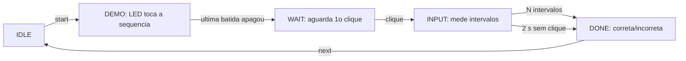

# Lógica da sequência rítmica

O módulo `rhythm_logic.c` gera a sequência, controla a demonstração no LED,
mede os intervalos entre cliques e decide o resultado. Não acessa GPIO, EXTI,
USB nem o SysTick: recebe timestamps já validados e devolve eventos.

## Convenções deste projeto

O enunciado fixa três trechos iniciais, curtos e longos, e o acréscimo de um
trecho a cada acerto. Os valores abaixo são **escolhas de implementação**,
ajustáveis em `rhythm_logic.h`:

| Parâmetro | Regra |
| --- | --- |
| Trecho | Intervalo entre dois cliques consecutivos; N trechos exigem N+1 cliques |
| Curto | Demonstrado com 300 ms; medido como menor que 600 ms |
| Longo | Demonstrado com 900 ms; medido como 600 ms ou mais |
| Prazo | 2000 ms sem clique, depois do primeiro, encerram a tentativa |
| Clique | Borda de pressão validada; a soltura não conta |
| Sequência inicial | 3 trechos sorteados, sempre com pelo menos um curto e um longo |
| Acerto | Acrescenta um trecho sorteado ao final, preservando os anteriores |
| Erro ou prazo | Repete a mesma sequência |
| Máximo | 12 trechos; acertá-lo reinicia com uma nova sequência de 3 |

O limiar de 600 ms fica no meio entre 300 e 900 ms, com 300 ms de margem
para cada lado. O sorteio usa xorshift32, como na questão (b): varia entre
sessões, mas não é uma fonte de entropia.

## Fases

- **DEMO:** a primeira batida ocorre 1000 ms após `start`. Cada batida acende
  o LED por 100 ms; os intervalos entre batidas são os nominais da sequência.
  Cliques nessa fase são ignorados.
- **WAIT:** sem prazo. O primeiro clique apenas marca o início.
- **INPUT:** cada clique gera um evento com o intervalo medido, a classificação
  e o trecho esperado. A tentativa só termina no último intervalo, para que a
  serial mostre todos os erros. Então o evento final é `CORRECT` ou `WRONG`.
- **Prazo:** 2000 ms sem clique geram um evento `TIMEOUT` sem intervalo.
  Se o tick atrasar, o próprio clique tardio detecta o prazo e não é contado.
- **DONE:** cliques ignorados até `next`, chamado pelo `main` após o relatório.

## Limites e contrato

Intervalo de 599 ms é curto; 600 ms é longo. Um clique 1999 ms após o anterior
ainda é intervalo (longo); em 2000 ms a tentativa expira. Os instantes usam
subtração `uint32_t` e atravessam o zero do contador. Atrasos devem ser
menores que 2³¹ ms.

Para a integração: entregar o timestamp da borda que inicia a pressão estável
e suspender `tick` enquanto uma borda está em validação. Assim, uma pressão
aos 1999 ms conta, mesmo se for confirmada depois de 2000 ms. Uma rodada gera
no máximo 12 eventos, e a seguinte só começa após `next`. Por isso, uma fila
de 12 posições nunca transborda.
