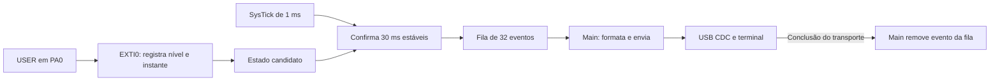

# Atividade 3 — Questão (a)

## Resultado

O firmware da Black Pill STM32F411CEU6 detecta o botão USER/KEY por interrupção
externa, confirma o pressionamento após 30 ms de estabilidade e transmite seu
número e timestamp pela serial USB CDC. Exemplo de formato:

```text
Sistema iniciado...
Botao 1 pressionado em 2387 ms
```

Há um evento por pressionamento validado. Manter o botão apertado não repete;
soltar não incrementa. É necessária uma soltura estável de 30 ms para permitir
o próximo pressionamento. Este trabalho abrange somente a questão (a).

## Placa e conexões

| Recurso | Configuração |
| --- | --- |
| Placa | Black Pill, STM32F411CEU6; Flash de 512 KB e RAM de 128 KB |
| Alimentação e comunicação | Cabo USB de dados entre a placa e o computador |
| Botão USER/KEY | PA0, entrada com pull-up; pressionado = 0, solto = 1 |
| LED de usuário | PC13, ativo em nível baixo; alterna a cada 500 ms |
| USB Full Speed | PA11/D− e PA12/D+, AF10; ligados ao conector da placa |
| Clock | CPU/AHB 96 MHz, APB1 48 MHz, APB2 96 MHz, USB 48 MHz |
| HSE | Configurado para 25 MHz; marcação do cristal não identificada visualmente |
| Gravação | Bootloader de fábrica em modo USB DFU |

O fluxo usa somente o USB da placa. Não exige ST-Link nem adaptador USB/UART.
USER/KEY é diferente de BOOT0 e RESET/NRST. Os pinos USB não requerem jumpers.
O funcionamento do USB e o ritmo observado do LED são compatíveis com o HSE
presumido, mas não constituem medição instrumental dos clocks.

## Compilar, gravar e executar

Abra **ELEW32** como pasta do VS Code. Instale ARM GNU Toolchain, CMake e Ninja
no Windows e deixe-os no PATH; use as extensões C/C++ e CMake Tools. As versões
efetivamente utilizadas estão no [histórico do projeto](../README.md).

Na raiz do projeto:

```powershell
cmake -S template -B out/build/windows -G Ninja -DCMAKE_BUILD_TYPE=Debug -DCMAKE_EXPORT_COMPILE_COMMANDS=ON
cmake --build out/build/windows
```

Ou execute **CMake: Build** / **Ctrl+Shift+B** no VS Code. O build gera ELF,
HEX, BIN e MAP em `out/build/windows/`, ignorado pelo Git. As dependências
CMSIS, HAL e USB estão versionadas em [template/vendor](../template/vendor/README.md);
a compilação não baixa bibliotecas. O diretório antigo `template/build/`
foi preservado e não deve ser reutilizado no Windows.

Para gravar:

1. Execute **DFU: Setup** uma vez para preparar dfu-util 0.11.
2. Com USB conectado, segure BOOT0, aperte e solte RESET, espere meio segundo
   e solte BOOT0. O Windows deve reconhecer **STM32 BOOTLOADER (0483:DF11)**.
3. Se necessário, instale WinUSB para esse dispositivo usando Zadig, conforme
   as instruções de gravação do README. Esse driver já foi instalado na máquina
   usada nos testes.
4. Execute **DFU: Flash and Verify**. O script compila, grava em `0x08000000`
   e compara o SHA-256 do BIN com a leitura de volta da Flash.
5. Após o sucesso, pressione RESET com BOOT0 solto. O LED deve piscar.

O mesmo fluxo pode ser chamado pelo terminal:

```powershell
powershell -NoProfile -ExecutionPolicy Bypass -File scripts/setup-dfu.ps1
powershell -NoProfile -ExecutionPolicy Bypass -File scripts/dfu.ps1 -Action List
powershell -NoProfile -ExecutionPolicy Bypass -File scripts/dfu.ps1 -Action Flash
```

No firmware, o Windows reconhece **USB CDC (0483:5740)** e usa o driver
`usbser`; nos testes, atribuiu **COM9**. Não troque esse driver pelo WinUSB
do bootloader. Para o terminal, execute **USB: Serial Monitor** ou:

```powershell
powershell -NoProfile -ExecutionPolicy Bypass -File scripts/serial-monitor.ps1
# Porta e duração explícitas, se necessário:
powershell -NoProfile -ExecutionPolicy Bypass -File scripts/serial-monitor.ps1 -Port COM9 -Seconds 60
```

O monitor seleciona automaticamente uma única placa CDC conectada. Usa
115200, 8N1, sem controle de fluxo, com **DTR ativo**. Feche outro terminal
que esteja usando a mesma porta. A mensagem inicial é enviada quando DTR
é ativado; reabrir o terminal também mostra `Sistema iniciado...`, sem
significar que ocorreu um reset. O baud rate informado não configura uma UART.

## Funcionamento e relação com a Aula 06

O material de referência é **2026_02 - ELEW32 - Sistemas Embarcados - Aula 06 -
CMSIS, Interrupções.pdf**, fornecido pelo professor e mantido fora deste
repositório. Os requisitos da atividade estão no [Enunciado.pdf](../Enunciado.pdf).
Os conceitos de acesso a registradores, vetor, prioridade e atendimento de
interrupção são aplicados assim:

| Conceito | Aplicação no firmware |
| --- | --- |
| CMSIS | Headers do Cortex-M4 e STM32F411 fornecem os registradores, máscaras e funções `NVIC_*`, `SysTick_Config` e intrínsecos de controle de interrupções |
| Startup e tabela de vetores | O startup inicializa `.data`/`.bss` e chama `main`. Os handlers C substituem os aliases `weak` do startup; VTOR aponta para `0x08000000` |
| GPIO e SYSCFG | GPIOA configura PA0 como entrada; `SYSCFG->EXTICR[0]` seleciona a porta A para a linha EXTI0 |
| EXTI | RTSR e FTSR detectam subida e descida. IMR libera a linha. O handler reconhece PR0 escrevendo 1 somente nesse bit (W1C) |
| NVIC | Habilita EXTI0 e USB; prioridades numéricas 0/1/2 para SysTick/EXTI0/USB. SysTick pode interromper EXTI0, que pode interromper USB |
| SysTick | `LOAD=95999` e clock da CPU de 96 MHz produzem um tick nominal de 1 ms. O handler incrementa o tempo e executa a verificação curta do debounce |
| ISR curta | EXTI0 registra o candidato; SysTick confirma e enfileira. Formatação e envio ficam no `main`, sem delay nem espera por USB livre nas ISRs |
| Dados compartilhados | Seções críticas curtas preservam PRIMASK para proteger estado e fila; `volatile` sozinho não protege operações sobre vários campos |

| Handler | IRQ | Entrada do vetor | Endereço da entrada |
| --- | --- | --- | --- |
| `SysTick_Handler` | Exceção do núcleo | 15 | `0x0800003C` |
| `EXTI0_IRQHandler` | 6 | 22 | `0x08000058` |
| `OTG_FS_IRQHandler` | 67 | 83 | `0x0800014C` |



Cada nova borda reinicia a espera de estabilidade. O timestamp preservado é
o início do intervalo estável validado, não a confirmação 30 ms depois. É uma
leitura do SysTick durante atendimento em software, com resolução de 1 ms,
e não uma captura de borda por hardware. A subtração unsigned permite calcular
o intervalo quando o contador de milissegundos volta a zero.

`HAL_GetTick()` consulta o mesmo contador da aplicação. HAL/PCD e middleware
ST são usados no suporte USB; a configuração e o atendimento do botão usam
diretamente CMSIS e registradores.

## Fila, perdas e limites

A fila mantém 32 pares de número/timestamp. O número aumenta em todo
pressionamento validado. Se não houver vaga, o evento novo é descartado e
incrementa o total de perdas; os anteriores ficam preservados. Após escoar
a fila, o terminal recebe, por exemplo, `Eventos perdidos: 3 (fila cheia)`.

Um evento só sai da fila depois de o USB concluir a transferência; ele ainda
ocupa uma vaga durante o envio. Quando o USB está ocupado ou DTR está desligado,
o `main` tenta novamente em outra iteração. Uma transferência abortada pela
reinicialização da classe permite nova tentativa do mesmo evento.

A conclusão USB não confirma leitura pelo programa no computador. Não há
protocolo de confirmação da aplicação, nem garantia de entrega exatamente uma
vez em toda desconexão; o número do evento identifica possíveis repetições.

A fila e os contadores residem em RAM. RESET ou perda da alimentação apagam
seu conteúdo. Como a placa é alimentada pelo próprio USB, retirar o cabo
também a desliga. Para testar a fila sem consumo, mantenha o cabo conectado
e feche o terminal. O firmware exige uma soltura estável inicial; ligar com
USER apertado não cria um pressionamento artificial.

## Validação registrada em 13/10/2026

Firmware da etapa 6: commit **13cf5dd**. A etapa final altera apenas documentação
e evidências. Foi compilado novamente em `out/build/final-validation/`, sem
reutilizar o cache anterior: build sem avisos, **14672 bytes de Flash** e
**3380 bytes de RAM estática**, além da pilha em execução. ELF, HEX, BIN e MAP
foram gerados. O BIN novo é idêntico à leitura de Flash verificada na etapa 6:

```text
SHA-256: B85BA221636AD17D3B79897A145CFA881A6BBAB72179133FD29885DB5810DDAB
```

Os testes C foram executados novamente com sucesso:

```powershell
# Primeira vez: acrescentar -Setup para preparar o compilador nativo de testes.
powershell -NoProfile -ExecutionPolicy Bypass -File scripts/test-button.ps1
```

Eles compilam os mesmos fontes de lógica e envio do firmware, com adaptadores
simulados de hardware/USB. Não simulam todo o microcontrolador nem comprovam
temporização elétrica ou concorrência real das interrupções.

| Verificação | Método e resultado |
| --- | --- |
| Build e gravação | Compilação nova aprovada; BIN idêntico à Flash previamente lida. Vetores e handlers inspecionados nas etapas anteriores |
| Cliques sucessivos | Placa: três pressionamentos produziram exatamente eventos 1, 2 e 3 |
| Botão mantido e soltura | Placa: terceiro pressionamento mantido por cerca de 5 s não repetiu; soltura não gerou evento adicional |
| Bouncing e limiar de 30 ms | Teste C: oscilações simuladas, pulso de 29 ms e soltura insuficiente rejeitados; confirmação aos 30 ms e timestamp original aprovados. Não houve injeção ou medição física controlada de bouncing |
| Fila cheia sem terminal | Placa: após RESET, 35 cliques com COM fechada produziram eventos 1–32 em ordem e um aviso de 3 perdas |
| Recuperação da fila | Placa: após escoar a fila, mais um clique produziu o evento 36; o aviso de perdas não repetiu |
| Reinicialização | Placa: RESET reiniciou a contagem em 1 no teste de 35 cliques |
| Reconexão física USB | Placa: retirada/reconexão do cabo trouxe COM9 e mensagem inicial; primeiro clique voltou ao evento 1, coerente com perda de alimentação |
| Reabertura do terminal | Placa: saudação reapareceu, e os eventos guardados foram transmitidos sem reiniciar a contagem |
| Limite de `uint32_t` | Teste C: borda em `UINT32_MAX - 10`; em 18 ms transcorreram 29 ms (rejeita), em 19 ms transcorreram 30 ms (confirma). Não foi aguardada uma volta completa de aproximadamente 49,7 dias na placa |
| Falha/ocupação de USB e aviso de perdas | Teste C do consumidor: mantém evento enquanto ocupado, tenta novamente após aborto e remove somente após conclusão; perdas novas durante um aviso permanecem pendentes |
| Reutilização circular | Teste C: 1000 ciclos de inserção/remoção após saturação, mantendo ordem e contagem |

Evidências preservadas no repositório:

- [Três pressionamentos e botão mantido](evidencias/tres-pressionamentos.txt).
- [Fila cheia: 32 eventos e 3 perdas](evidencias/fila-cheia.txt).
- [Próximo evento após a fila cheia](evidencias/apos-fila-cheia.txt).
- [Reconexão física do USB](evidencias/reconexao-usb.txt).
- [Resultado dos testes C](evidencias/testes-c.txt).

Não houve ST-Link, osciloscópio ou analisador lógico. Não foi testada uma
desconexão USB com alimentação independente nem uma interrupção física
controlada no meio de um pacote. Essas limitações não são descritas como
testes físicos aprovados.

## Repetir a demonstração

1. Reinicie com BOOT0 e USER soltos e abra **USB: Serial Monitor**.
2. Faça dois cliques e um pressionamento de 5 s: espere três mensagens, nenhuma
   repetição durante a pressão longa e nenhuma mensagem adicional na soltura.
3. Feche o terminal, reinicie e faça 35 cliques, com pelo menos meio segundo
   entre eles. Reabra: espere eventos 1–32 e aviso de 3 perdas.
4. Faça outro clique: espere evento 36.
5. Feche o terminal, desconecte/reconecte o USB e faça um clique. Reabra:
   espere a saudação e evento 1. A fila anterior não persiste sem energia.
6. Execute **Button: Tests** para repetir os casos simulados de estabilidade,
   fila, transmissão e passagem de `uint32_t` por zero.
